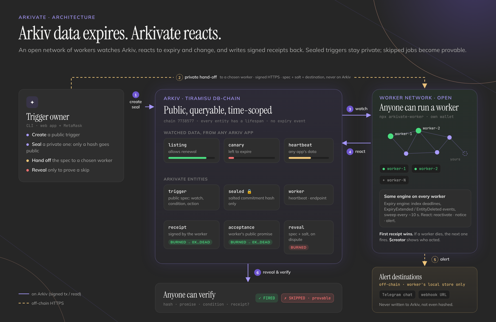

# Arkivate: Arkiv data expires. Arkivate reacts.

Open-source triggers for Arkiv data, run by an open network of workers that leave a burned, public
receipt for every reaction, so a skipped job can be proven.

| | |
|---|---|
| **Network** | Arkiv Tiramisu testnet, chain ID `7738577` |
| **Tracks** | Open Source · Censorship Resistance · Privacy |
| **Live app** | https://arkivate.vercel.app |
| **worker-1 `/health`** | https://34-136-53-253.sslip.io/health (us-central1) |
| **worker-2 `/health`** | https://34-74-197-9.sslip.io/health (us-east1) |
| **Demo video** | TODO: video link |
| **License** | [MIT](LICENSE) |

> Testnet only. All data is synthetic.

## TL;DR

- **Problem:** every Arkiv entity expires, but Arkiv emits no expiry event, so every app writes its
  own watcher, and the automation that does exist runs on one operator who can skip a job silently
  and sees everything you automate.
- **What it does:** you post a trigger ("when X happens on Arkiv, do Y"); any worker in an open
  network watches for it, and the first to act writes a readonly receipt burned to `0x…dEaD`, so
  nobody can delete it, the worker included.
- **Reactivate:** a trigger can keep data alive. The worker extends the entity and writes its receipt
  in one atomic transaction, up to a cap you set.
- **Sealed triggers:** only a salted hash of your trigger goes on Arkiv. The spec and the alert
  destination go privately to one worker you choose; the destination never touches Arkiv, not even
  hashed.
- **Provable censorship:** if that worker skips your sealed job, you reveal the spec and anyone can
  run `verify` and get `SKIPPED`, using public reads only.

## Contents

1. [The problem, and who has it](#the-problem-and-who-has-it)
2. [How Arkivate works](#how-arkivate-works)
3. [Conditions and actions](#conditions-and-actions)
4. [Why this pillar](#why-this-pillar)
5. [Why Arkiv](#why-arkiv)
6. [How Arkivate uses Arkiv](#how-arkivate-uses-arkiv)
7. [Try it yourself (for judges)](#try-it-yourself-for-judges)
8. [What works, and what doesn't yet](#what-works-and-what-doesnt-yet)
9. [Key decisions and trade-offs](#key-decisions-and-trade-offs)
10. [Entity schema](#entity-schema)
11. [Friction report](#friction-report)
12. [Code tour](#code-tour)
13. [Tests](#tests)
14. [Deployment](#deployment)
15. [Run it locally](#run-it-locally)
16. [Wallets](#wallets)
17. [Tech stack and credits](#tech-stack-and-credits)
18. [How this was built](#how-this-was-built)
19. [Roadmap](#roadmap)
20. [Acknowledgments and license](#acknowledgments-and-license)

## The problem, and who has it

**Expiry is silent.** Every Arkiv entity has a lifespan, and when it ends the entity is simply gone.
The event stream has `EntityCreated`, `EntityPatched`, `ExpiryExtended`, `OwnershipTransferred` and
`EntityDeleted`, but no expiry event, because expiry happens without a transaction
([F12](arkiv/friction.md#f12--no-expiration-event-expiry-has-to-be-detected-by-sweeping)). A read
of a missing entity can't even say whether it expired or was deleted
([F13](arkiv/friction.md#f13--noentityfounderror-cant-tell-expired-from-deleted-or-never-existed)).

**Every app builds its own detection.** Because nothing is emitted when an entity expires, any Arkiv
app that needs "notice when this changes, renew it before it expires, alert me when it dies" has to
write its own poller or deadline sweeper and keep a server running for it.

**Automation today has one operator.** Whoever runs the cron job or the bot can skip a job and
nobody can prove it, can be pressured to stop, and sees every rule you automate, including the ones
that reveal what you hold or care about.

**Intended users:**

- Arkiv app builders who need reactions to their data without running watcher infrastructure.
- People who need data kept alive (a listing, a registration, a record) past its default lifetime.
- Anyone who needs an alert when public data changes, goes quiet or dies, without telling the world
  what they are watching.

## How Arkivate works

[](docs/assets/architecture.png)

A trigger owner posts a trigger (public) or a commitment (sealed). Workers watch Arkiv, react, and
write receipts back to Arkiv. Sealed specs and alert destinations travel only over HTTPS to one
chosen worker. Anyone can verify what happened from public reads.

### Flow 1: Reactivate (keep-alive)

Real run on Tiramisu (16 Oct; these entities have since expired): listing **L1** `0x132af2af…` (`demo_feed`, `kind = listing`, created with
`permissionlessExtension`), keep-alive trigger `0xd4ce919d…` with `lead_blocks 40`,
`extend_blocks 120`, `max_extensions 2` ([spec](backend/cli/examples/keep-alive.json)).

1. **Post** the trigger: a `trigger` entity whose payload is the full spec
   ([tx `0x92c875e1…`](https://tiramisu.explorer.arkiv.network/tx/0x92c875e15eb26af4342f2817feaa8d5acfdde8181be9f832687351a12da61e7c), block 654706).
2. **Index** the deadline: every worker indexes L1's `expiresAt` (654818) and sweeps it against the
   head every 10 s.
3. **Fire** at `654818 − 40`: at block 654778 the head enters the lead window. worker-1 (rank 0)
   checks that no registered worker has a receipt for this epoch yet.
4. **Extend and receipt, atomically:** one `executeBatch` extends L1 to `ExpirationTime.atBlock(654938)`,
   creates a readonly receipt (`outcome = extended`, `old_expires_at 654818`, `new_expires_at 654938`)
   and transfers it to `0x…dEaD`. L1 is extended if and only if the receipt exists
   ([tx `0xc96671e0…`](https://tiramisu.explorer.arkiv.network/tx/0xc96671e0142a42133a1ae09978c56ad9ee050b461aa64e795c6b88fc4a865501), block 654781).
5. **Repeat** for the new deadline: 654938 → 655058
   ([tx `0x90d93bbb…`](https://tiramisu.explorer.arkiv.network/tx/0x90d93bbb2360bab050080415e387a25ab8ff4cccf502b606bec8da68eb95d299), block 654901).
6. **Stop at the cap:** two `extended` receipts exist (counted across all registered workers, not
   just this one), so the third firing writes `outcome = cap_reached` and leaves L1 to expire at 655058
   ([tx `0x8c414a7d…`](https://tiramisu.explorer.arkiv.network/tx/0x8c414a7d2031a9ff1e5eb121313da56275225c2a407407953117d3dc599a24d4), block 655021).

If the target isn't extendable by the worker (no `permissionlessExtension`, not owned by it), the
receipt says `not_extendable` and nothing else happens
([tx `0x5fa6ff10…`](https://tiramisu.explorer.arkiv.network/tx/0x5fa6ff10dfb91170fc0c00b266b611b935585a47a8944f354727fde2885200a3)).

### Flow 2: Expire, renew, delete

The expiry engine ([`backend/worker/src/expiry.ts`](backend/worker/src/expiry.ts)) keeps a persisted
index `entity key → expiresAt` for everything a trigger watches, rebuilt every 5 minutes at one
pinned block and kept fresh by WebSocket events in between.

| Event | How a worker detects it | Real run |
|---|---|---|
| **Expired** | 10 s sweep: head ≥ `expiresAt`, then re-read; gone and no delete seen → expired | canary `0x89538f96…`, `expiresAt 654834`, confirmed at head 654838, receipt mined at 654841 |
| **Renewed** | `ExpiryExtended` over WebSocket, or a later `expiresAt` found on rebuild | `on_extend` fired for `0xbd8b1748…` at 654773; the `on_expiring` trigger on the same entity re-armed for the new deadline and fired at 654988 |
| **Deleted** | `EntityDeleted` over WebSocket, or the entity vanishing **before** its known `expiresAt` | `on_delete` fired for `0x5a06771e…` at 654775; the `on_expire` trigger on the same entity never fired |

`NoEntityFoundError` is the same for "expired", "deleted" and "never existed". The engine tells them
apart from evidence it already holds: a seen delete event, or a disappearance before the deadline
(expiry can't come early), means deleted; otherwise expired.

### Flow 3: Sealed trigger

1. **Commit:** the owner computes `commitment = keccak256(canonical_json(spec) ‖ salt32)` locally and
   posts a `sealed` entity holding only the commitment and the chosen worker's address, from a
   separate wallet ([tx `0xa75c6e40…`](https://tiramisu.explorer.arkiv.network/tx/0xa75c6e4005441d5f1dcaa9317789eedf6bc5dfef37e422eabd964aed9f9a040c)).
2. **Hand off:** the owner sends `{ spec, salt, destination }` to the worker's `POST /sealed`, signed
   with EIP-191 over the sealed key, commitment, worker address and a local-only digest of the
   destination. The worker checks the entity names it, the spec and salt open the commitment, and
   the signer is the sealed entity's `$creator`.
3. **Accept:** the worker writes a burned `acceptance` (commitment, sealed creator, `accepted_block`),
   so it can't withdraw the promise later
   ([tx `0x7adc6a94…`](https://tiramisu.explorer.arkiv.network/tx/0x7adc6a94b9d9d5d65f0767c374b60d424ca02adfbbb1220dff5d67ade12dabfd)).
4. **Fire:** when the condition holds, the worker delivers to the webhook or Telegram chat, then
   writes a burned receipt whose `epoch` is `keccak256(salt ‖ raw_epoch)` and whose payload is only
   `{ result_hash }` ([example tx `0x5e552402…`](https://tiramisu.explorer.arkiv.network/tx/0x5e552402804fb769ed6c567b075d181357c95ecc62f827720a7e4bc7b7ee0ec4)).

### Flow 4: Provable censorship

Real run (16 Oct; since expired): sealed `0x24087b8f…` names **worker-2**, which ran with the demo switch `SKIP_SEALED=true`
(accept sealed jobs, never fire them).

1. worker-2 **accepted** at block 655806.
2. A matching event `0xb9e5ac49…` was **created** at block 655860
   ([tx `0x62576981…`](https://tiramisu.explorer.arkiv.network/tx/0x625769815b1b1493eecad5bf066fe0e29bc2e365e3a438d3ee2e3101ca85183e)).
   worker-1's sealed jobs on the same event fired within 4–6 blocks.
3. The **deadline** passed at 655860 + 150 = **656010** with no sealed receipt from worker-2.
4. The owner **revealed** `{ spec, salt }` in a burned `reveal` at 655904
   ([tx `0x734f711f…`](https://tiramisu.explorer.arkiv.network/tx/0x734f711f49f36c40f1d43274c809b12ba113421ca254de4a7da001cc48eb7979)).
5. **`verify`** recomputes the commitment, finds worker-2's burned acceptance, replays the condition
   (hit at 655860), finds no receipt whose epoch matches `keccak256(salt ‖ "create:0xb9e5ac49…")`
   by 656010, and returns **`SKIPPED`**.

Honest caveat: the event had a 60-minute lifetime, and `verify` replays the condition at the current
head, so today the same command returns `NOT_TRIGGERED`. Replaying at block 656100 returns `SKIPPED`
with every step passing. See [What works, and what doesn't yet](#what-works-and-what-doesnt-yet) and
[`docs/verification.md`](docs/verification.md).

### The worker network

**Anyone runs a worker.** A worker is the same open-source process on any host, with its own
wallet. It announces itself with a `worker` entity (name, version, public hand-off endpoint), signed
by that wallet, with a 1-day lifetime that it extends every 6 hours. A worker that stops simply
drops out when its entity expires.

**Dedupe for N workers.** Each worker lists the live `worker` entities and sorts their creator
addresses; its position is its rank. Rank 0 fires immediately; rank *n* waits *n* × 12 s (capped at
36 s), then re-checks Arkiv for a receipt from any registered worker for the same `(trigger, epoch)`
and skips if one exists. First receipt wins; everyone else skips. Receipts from addresses without a
live `worker` entity are ignored, so they can't be used to suppress firings.

**Failover, measured with the reference workers** (block time is 2 s):

| Case | Event block → receipt mined | Source |
|---|---|---|
| worker-1 (rank 0) fires | 3–4 blocks (6–8 s) in most firings | public receipts by `0xBd9d…` |
| worker-1 down, worker-2 (rank 1) fires | 650462 → 650472: 10 blocks (20 s), about the 12 s slot more | receipt `0xda13afc2…` by `0xDE94…` |
| worker-1 up, worker-2 sees its receipt and skips | 5 epochs skipped by worker-2 as a peer; the one duplicate came from the earlier 2 s slot (F7) | worker-2 job store, receipts on Arkiv |

**`$creator` shows who acted.** Each worker signs with its own wallet, so every receipt's `$creator`
is the worker that fired it, and nobody else can write a receipt in its name.

### Join the network

```bash
git clone https://github.com/NatX223/Arkivate.git && cd Arkivate
corepack enable && pnpm install
pnpm wallets                 # prints fresh keys + addresses; writes nothing
cp .env.example .env         # WORKER_NAME, WORKER_PRIVATE_KEY, ARKIV_ACCESS_KEY
# fund the worker address: https://hub.arkiv.network/faucet
pnpm worker
```

What it needs:

- **A funded wallet** (testnet GLM). Unfunded, the worker runs in read-only dry-run mode and logs
  what it would fire.
- **An Arkiv access key** (recommended): a worker polls constantly and the keyless RPC allows about
  100 queries per hour per IP.
- **Optional:** `PUBLIC_ENDPOINT` to accept sealed hand-offs, `TELEGRAM_BOT_TOKEN` for Telegram
  delivery, and `TRIGGER_CREATORS`, an optional gas guard that limits public triggers and sealed
  hand-offs to addresses you choose. Leave it empty to accept every creator, as the reference
  workers do during judging; `MAX_RECEIPTS_PER_TRIGGER_PER_HOUR` (default 12) caps spam either way.

The worker isn't published to npm yet, so there is no `npx` one-liner; it runs from a clone. Hosting
on a small VM is in [`docs/deployment.md`](docs/deployment.md) and [`docs/deploy-vm.md`](docs/deploy-vm.md).

## Conditions and actions

| Condition | Fires when | One receipt per (epoch) | Detected by |
|---|---|---|---|
| `on_create` | a new entity matching `where` (and `created_by`, if set) is created after the trigger | matched entity: `create:<key>` | `EntityCreated` over WebSocket, batched every 2 s; 5-minute catch-up query |
| `on_silence` | the newest matching entity from the trusted `created_by` is older than `silence_blocks`, or none is live | silence episode: `silence:<last key>` | 30 s poll (uses creation block, so extending an old heartbeat can't mask silence) |
| `on_count` | the filtered count satisfies `count_op count_value` | ~1 h bucket: `count:<head / 1800>` | 30 s poll via raw `arkiv_getEntityCount` |
| `on_expiring` | head ≥ deadline − `lead_blocks` | deadline: `expiring:<subject>:<deadline>` | 10 s sweep of the expiry index |
| `on_expire` | the deadline has passed and the entity is gone (`follow`), or the pinned deadline has passed (`pinned`) | deadline: `expire:<subject>:<deadline>` | 10 s sweep, then a re-read |
| `on_extend` | the entity's expiry moved later | new expiry: `extend:<subject>:<new_expires_at>` | `ExpiryExtended`, or a later `expiresAt` on rebuild |
| `on_delete` | the entity was deleted | once: `delete:<subject>` | `EntityDeleted`, or gone before its deadline |

Expiry conditions watch one entity (`watch: { entity_key }`) or every entity matching a query
(`watch: { where, created_by? }`). Literals are typed (`{str}`, `{u64}`, `{addr}`, …) so a spec can
never fall into the bare-number-is-`i32` trap. Spec reference: [`arkiv/schema.md`](arkiv/schema.md#trigger).

| Action | Usable in | What happens |
|---|---|---|
| `extend` (Reactivate) | public triggers, with `on_expiring` only | extend to `old_expires_at + extend_blocks` in the same batch as the receipt; `max_extensions` ≤ 100, counted across all registered workers; outcomes `extended` / `not_extendable` / `cap_reached` |
| `notice` | public triggers | the burned receipt is the whole effect: a public, permanent "this happened" |
| `webhook` | sealed triggers | `POST` JSON to the private URL, with `Idempotency-Key` = the hashed epoch |
| `telegram` | sealed triggers | a bot message to the private chat; needs `TELEGRAM_BOT_TOKEN` on the worker |

`on_extend` + `extend` is rejected as a loop, and `extend` after `on_expire` / `on_delete` is rejected
because there is nothing left to extend.

**Follow vs pinned deadlines.** `follow` (default) measures against the entity's current
`expiresAt`, so a renewal moves the deadline and re-arms `on_expiring`. `pinned` records `expiresAt`
the first time the trigger sees the entity and never moves it. Pinned exists because
`ExpiryExtended` doesn't say who extended
([F14](arkiv/friction.md#f14--extendentity-sets-an-expiry-rather-than-adding-to-it-and-expiryextended-doesnt-say-who-extended)):
with `permissionlessExtension`, anyone can keep postponing a `follow` deadline. Real run on
`0xa84e0021…`, extended 654852 → 654952: the pinned `on_expire` fired at 654853, the follow one at
654953.

## Why this pillar

The people below are illustrative scenarios, not real users.

### Censorship Resistance

**Who is harmed:** a seller has a 7-day listing on an Arkiv marketplace and relies on the
marketplace's renewal bot to keep it alive. The bot's operator is pressured to push the seller off
the market, so it quietly skips the renewal. The listing expires mid-sale, and the seller has
nothing to show that a renewal was ever owed. On their side it looks like bad luck.

**How Arkivate removes it:**

- **No single operator.** The seller's keep-alive trigger is public, and any worker in the network
  can run it. If one worker drops the job, the next one in rank fires 12 s later. Measured: with
  worker-1 down, worker-2 extended on its own (20 s from event to receipt).
- **Every renewal leaves proof.** The extension and a burned receipt land in one transaction (Flow 1),
  so "renewed" and "receipt exists" can't diverge, and no worker can delete its receipt afterwards.
- **A skip becomes evidence.** For a sealed job, the assigned worker's acceptance is burned. If it
  never fires, the owner reveals, and `verify` returns `SKIPPED` from public reads (Flow 4: met at
  655860, deadline 656010, no receipt).

### Privacy

**Who is harmed:** someone holds a position in a small protocol and wants an alert if that
protocol's heartbeat entity on Arkiv goes quiet. Posting the rule to a public automation service
tells everyone what they hold and when they will react. The webhook URL in the rule points at their
own server.

**How Arkivate removes it:**

- **Only a salted hash goes public.** A sealed trigger puts `keccak256(spec ‖ salt)` and the chosen
  worker's address on Arkiv. The spec travels only to that worker, over a signed HTTPS hand-off.
- **Destinations never touch Arkiv, not even hashed.** Webhook URLs and Telegram chat IDs stay on the
  owner's machine and the chosen worker's local store. A scan of every live `project = arkivate`
  entity for our test destinations and their digests found 0 hits.
- **We closed a leak in our own design** ([F17](arkiv/friction.md#f17--our-design-worth-a-line-in-arkivs-privacy-docs-hashes-of-public-data-arent-private-on-arkiv)).
  Sealed receipts first published `keccak256("create:" + matched_key)`, which anyone can brute-force
  over public entity keys. Two jobs on the same event produced identical epochs (receipts
  `0x591e449e…` and `0x33aba737…`). The epoch now mixes in the job's secret salt.
- **What still leaks:** a sealed receipt shows **that** a sealed trigger fired, **when**
  (`evidence_block`), and which worker ran it. It never shows **what** was watched or **where** the
  alert went.

### Open Source

**Who is harmed:** a developer building a new Arkiv app needs "renew this before it expires" and
"tell me when it's gone". Arkiv has no expiry event ([F12](arkiv/friction.md#f12--no-expiration-event-expiry-has-to-be-detected-by-sweeping))
and can't tell expired from deleted ([F13](arkiv/friction.md#f13--noentityfounderror-cant-tell-expired-from-deleted-or-never-existed)).
So the developer spends days writing a deadline index, a sweeper and a server to host them, and the
day they stop paying for that server, their users' data starts expiring.

**How Arkivate removes it:**

- **One shared engine.** The developer posts a trigger in a documented JSON spec
  ([examples](backend/cli/examples/)) instead of writing a watcher. Expiry detection, expired vs
  deleted, dedupe and receipts are already solved, under MIT.
- **An open network.** The workers that run the trigger aren't the developer's to keep alive. Anyone
  can add one from a clone with their own wallet ([Join the network](#join-the-network)), and each
  worker shows up on Arkiv as a plain `worker` entity.
- **Plain Arkiv data.** Triggers, receipts and acceptances are ordinary entities, so another app can
  read and build on them without running our code.

## Why Arkiv

Arkivate needs four things from its data layer: data with a lifespan to react to, receipts that
nobody can edit or delete, an authenticated author on every record, and queries any worker can ask
directly ("has a registered worker already fired this epoch?"). This is what breaks without Arkiv:

| If Arkivate used… | What breaks for Arkivate | Why |
|---|---|---|
| **Postgres** | Receipts stop being proof, and workers can't share state. | The database admin can `UPDATE` or `DELETE` any receipt, so "the job fired" or "the job was skipped" becomes the operator's word. Independent workers would all need write access to one database, and whoever runs it can lock them out. |
| **IPFS** | Dedupe, expiry and authorship all disappear. | Content is immutable but can't be queried by attribute, so "receipts for trigger T, epoch E" needs a separate index. Content has no lifespan, so there is nothing to react to. A CID proves content, not who published it, so every receipt would need its own signature scheme. |
| **A subgraph** | Arkivate could read but not write, and couldn't see expiry. | A subgraph indexes events from a chain. It can't hold triggers or receipts, and expiry emits no event ([F12](arkiv/friction.md#f12--no-expiration-event-expiry-has-to-be-detected-by-sweeping)), so there is nothing to index. Every read would also trust the indexer's operator and lag behind the chain. |
| **Our own API** | We become the single operator Arkivate exists to replace. | We could skip jobs silently, be pressured to drop a trigger, and see every rule and destination. Other workers could only join if we let them, and nobody could check our history. |

On Arkiv, entities expire by design; `readonly` plus a transfer to `0x…dEaD` makes a receipt
permanent; `$creator` authenticates every write without a scheme of our own; and attribute queries
answer the dedupe question in one call.

**Kept off Arkiv on purpose:**

- **Alert destinations** (webhook URLs, Telegram chat IDs): they identify a person or their
  infrastructure. Even hashed they can be brute-forced, because chat IDs and URLs are low-entropy
  ([F17](arkiv/friction.md#f17--our-design-worth-a-line-in-arkivs-privacy-docs-hashes-of-public-data-arent-private-on-arkiv)),
  and the hackathon rules ban personal data in any form.
- **The destination digest the hand-off signature covers:** it is a hash of the destination, so the
  same brute-force reasoning applies. Only the owner and the chosen worker need it.
- **Sealed specs and salts before a reveal:** the spec is the intent being protected, and the salt
  would let anyone open the commitment. They are published only if the owner opens a dispute.
- **Private keys and the Arkiv access key:** they are credentials. Keys live in `.env` (on a worker
  VM, `/opt/arkivate/.env`, mode 600), and the access key stays server-side; the web app's read proxy
  adds it.
- **Real identities** (names, emails): nothing in Arkivate needs them. Trust comes from wallet
  addresses (`$creator`), and all demo data is synthetic.

Our sealed-flow test scanned every live `project = arkivate` entity (attributes and payloads, plain
and hex) for the test destinations and their digests: 0 hits.

## How Arkivate uses Arkiv

Only the features the design rests on. Remove any one row and a part of the product stops working.

| Arkiv feature | Product need it serves | Where in code |
|---|---|---|
| **Entity expiration** | The thing Arkivate reacts to (keep-alive, `on_expiring`, `on_expire`). It also maintains the worker network: a worker's 1-day registration lapses when it stops heartbeating, so dead workers leave without anyone removing them. Arkiv emits no expiry event, so workers index deadlines and sweep them (F12). | [`worker/src/expiry.ts`](backend/worker/src/expiry.ts) `sweep`; [`worker/src/chain.ts`](backend/worker/src/chain.ts) `register` / `heartbeat` |
| **`permissionlessExtension` + `extendEntity` to `ExpirationTime.atBlock`** | Reactivate: a worker can keep *someone else's* data alive without owning it, to an exact block (relative durations count from now, F14). | [`worker/src/engine.ts`](backend/worker/src/engine.ts) `planReactivate`; [`worker/src/chain.ts`](backend/worker/src/chain.ts) `writeReceipt` |
| **`readonly` + ownership transfer to `0x…dEaD`** | Evidence nobody can edit or delete, not even the worker that wrote it. That permanence is what turns a missing receipt into a provable skip. Applied to receipts, acceptances and reveals. | [`worker/src/chain.ts`](backend/worker/src/chain.ts) `writeReceipt` / `writeAcceptance`; [`cli/src/index.ts`](backend/cli/src/index.ts) `reveal` |
| **`executeBatch` + `predictEntityKeys`** | Atomic Reactivate: extend + create receipt + burn in one transaction, so the data is extended if and only if the receipt exists. | [`worker/src/chain.ts`](backend/worker/src/chain.ts) |
| **`$creator` (`.createdBy`, `$creator = addr(…)`)** | Trust without accounts: only receipts from registered workers count for dedupe, only the sealed owner's reveal counts in a dispute, and a worker accepts a hand-off only if it is signed by the sealed entity's creator. | [`worker/src/engine.ts`](backend/worker/src/engine.ts) `peerReceipt`; [`core/src/verify.ts`](backend/core/src/verify.ts); [`worker/src/handoff.ts`](backend/worker/src/handoff.ts) |
| **Attribute queries with typed values** | Coordination between independent workers through Arkiv alone: "is there a receipt for (trigger, epoch)?" is one query. The same queries evaluate conditions, and a filtered `arkiv_getEntityCount` drives `on_count` (F4). Blocks are `u64`, so comparisons are correct. | [`core/src/records.ts`](backend/core/src/records.ts) `findReceipts`; [`core/src/query.ts`](backend/core/src/query.ts); [`core/src/conditions.ts`](backend/core/src/conditions.ts) `countMatching` |
| **Live entity events** (`EntityCreated`, `ExpiryExtended`, `EntityDeleted`) | Reactions within seconds: `on_create`, `on_extend` and `on_delete` fire from events, and renewals keep the expiry index current between rebuilds. | [`worker/src/engine.ts`](backend/worker/src/engine.ts) `watch` |
| **`atBlock` reads** | Consistent snapshots of everything a trigger watches, paged at one block. The planned dispute fix replays evidence at the reveal block (F19). | [`core/src/expiry.ts`](backend/core/src/expiry.ts) `snapshotWatch`; [`core/src/conditions.ts`](backend/core/src/conditions.ts) `evalOnSilence` |

**Measurements** (Tiramisu, 16 Oct 2026; block time 2 s):

| Metric | Value | Source |
|---|---|---|
| Gas per write | 105k–169k gas = 0.00011–0.00017 GLM at 1 gwei. Public receipt 138,488; Reactivate (receipt + extend + burn) 168,952; sealed receipt 136,600; acceptance 130,384; seal 105,384; reveal 120,424 | `eth_getTransactionReceipt` on the txs in this README |
| Write latency (send → receipt) | 2.7–15.6 s for identical writes | [F15](arkiv/friction.md#f15--write-latency-varies-a-lot-27-s-to-156-s-on-2-s-blocks) |
| Event → receipt mined (rank 0) | 3–4 blocks typical; up to 18 when one worker fires many triggers at once (writes are serialised per wallet) | `evidence_block` vs creation block of every public receipt |
| Expiry detection lag | 4 blocks (`expiresAt 654834`, confirmed at 654838) | [F12](arkiv/friction.md#f12--no-expiration-event-expiry-has-to-be-detected-by-sweeping) |
| Failover delay | ~12 s rank slot; measured 20 s event → receipt with worker-2 alone vs 6–8 s for rank 0 | receipts above |

## Try it yourself (for judges)

Everything below uses entities and triggers you create yourself, so nothing has expired by the time
you look. You need MetaMask on Tiramisu (the site offers to add the network) and testnet GLM from
https://hub.arkiv.network/faucet. Reading and verifying need no wallet at all.

App: https://arkivate.vercel.app

1. **Get something to watch.**
   - **Option A: bring your own entity.** Paste the key of any Arkiv entity you already have on
     Tiramisu. Reactivate can only extend it if it was created with `permissionlessExtension`.
   - **Option B: emit demo entities from the CLI.**

     ```bash
     git clone https://github.com/NatX223/Arkivate.git && cd Arkivate
     corepack enable && pnpm install
     pnpm wallets                 # prints fresh keys + addresses; writes nothing
     cp .env.example .env         # set OWNER_PRIVATE_KEY from the output above
     # fund the owner address: https://hub.arkiv.network/faucet
     pnpm cli demo-feed --kind listing --blocks 300   # renewable by anyone, ~10 min
     pnpm cli demo-feed --kind canary --blocks 300    # only its owner can renew it, ~10 min
     ```

     Each line prints the new entity key and its explorer link. Your **CLI address** is the `owner`
     address `pnpm wallets` printed.
2. **Check the workers.** The **Workers** page shows both reference workers online (worker-1 in
   us-central1, worker-2 in us-east1), each with its address and `/health`.
3. **Reactivate in the UI.** **Create** → **Public** → *When to fire*: **About to expire** → *What to
   watch*: **A single entity** (paste your listing key), or **A query** with *Only from this creator*
   = your CLI address → action **Reactivate** → sign in MetaMask. On the trigger page you'll see
   `extended` receipts as each deadline approaches, then `cap_reached` once the cap is hit. Open any
   `extended` receipt's transaction in the explorer: the extension and the receipt are in the same
   tx.
4. **Sealed expiry → webhook alert.** Get a URL from https://webhook.site. **Create** → **Sealed**
   → **Expired** (or **About to expire**) → watch your canary → **Webhook** → paste the URL → worker
   **worker-1** → sign. Arkiv gets only the commitment; download the salt backup when offered. The
   trigger page shows worker-1's burned acceptance, and when the canary expires the alert arrives at
   webhook.site and a sealed receipt (`result_hash` only) appears on the trigger page.
5. **Provable censorship.** worker-2 runs with the demo switch `SKIP_SEALED=true`: it accepts sealed
   jobs and never fires them.
   1. **Create** → **Sealed** → **New entity appears** → *A query* with *Equals* = `event` (kind
      `event`) → Webhook → worker **worker-2** → sign.
   2. Wait for worker-2's acceptance on the trigger page, then `pnpm cli demo-feed --kind event`.
   3. Wait about 5 minutes (the 150-block grace window).
   4. On the trigger page, **Reveal spec** → sign, then **Verify it** → **`SKIPPED`**, with every
      step and the read behind it.

   The same steps with **worker-1** give **`FIRED`**. Sealed *expiry* triggers (step 4) verify as
   **`INCONCLUSIVE`**, because Arkiv can't tell "expired" from "deleted"
   ([F13](arkiv/friction.md#f13--noentityfounderror-cant-tell-expired-from-deleted-or-never-existed);
   see [`docs/verification.md`](docs/verification.md)).

**Verify without the UI.** These run against the public RPC with no key. Fill in your own values:

| Placeholder | Where it comes from |
|---|---|
| `<your trigger key>` | the trigger page URL, `/triggers/<key>`; or the key `pnpm cli create` prints |
| `<your sealed key>` | the sealed trigger's page URL, `/triggers/<key>`; or the key `pnpm cli seal` prints |
| `<worker address>` | the Workers page, or `address` in the worker's `/health` (worker-1 `0xBd9d8aB464aBe5fC9e52911F2d30D9f8144C7a5c`, worker-2 `0xDE94088D98368A81079a897a2278cc52BEeC3D1C`) |

Receipts of your public trigger (expect owner `0x…dead`, and for Reactivate the outcomes
`extended` … `cap_reached`):

```bash
curl -s https://rpc.tiramisu.db-chain.testnet.arkiv.network -H 'content-type: application/json' -d '{"jsonrpc":"2.0","id":1,"method":"arkiv_query","params":["project = str('"'"'arkivate'"'"') AND entity_type = str('"'"'receipt'"'"') AND trigger = key(<your trigger key>)",{"select":{"key":true,"creator":true,"owner":true,"attributes":true}}]}'
```

The chosen worker's burned acceptance of your sealed job:

```bash
curl -s https://rpc.tiramisu.db-chain.testnet.arkiv.network -H 'content-type: application/json' -d '{"jsonrpc":"2.0","id":1,"method":"arkiv_query","params":["project = str('"'"'arkivate'"'"') AND entity_type = str('"'"'acceptance'"'"') AND sealed = key(<your sealed key>) AND $creator = addr(<worker address>)",{"select":{"key":true,"owner":true,"attributes":true}}]}'
```

That worker's receipts for your sealed job (with worker-2, expect `"data":[]`):

```bash
curl -s https://rpc.tiramisu.db-chain.testnet.arkiv.network -H 'content-type: application/json' -d '{"jsonrpc":"2.0","id":1,"method":"arkiv_query","params":["project = str('"'"'arkivate'"'"') AND entity_type = str('"'"'receipt'"'"') AND trigger = key(<your sealed key>) AND $creator = addr(<worker address>)",{"select":{"key":true,"attributes":true}}]}'
```

`pnpm cli verify <your sealed key>` prints a curl command like these for every read it makes.

**From our test runs (16 Oct).** The entities behind these have since expired, but the transactions
stay visible in the explorer:

| Step | Transaction |
|---|---|
| worker-1 registers | [`0x00aaedd1…`](https://tiramisu.explorer.arkiv.network/tx/0x00aaedd115e0ccbca221e87e2cb54f9c5031cc9098aa4439102471b0eda1bcc1) |
| worker-2 registers | [`0x6f220b70…`](https://tiramisu.explorer.arkiv.network/tx/0x6f220b70ce8e00c230a0a8267e8deffb0e21b0d37b1e820815adbbb14b354200) |
| Post a keep-alive trigger | [`0x92c875e1…`](https://tiramisu.explorer.arkiv.network/tx/0x92c875e15eb26af4342f2817feaa8d5acfdde8181be9f832687351a12da61e7c) |
| Reactivate: extend + receipt + burn | [`0xc96671e0…`](https://tiramisu.explorer.arkiv.network/tx/0xc96671e0142a42133a1ae09978c56ad9ee050b461aa64e795c6b88fc4a865501) |
| Reactivate: `cap_reached` | [`0x8c414a7d…`](https://tiramisu.explorer.arkiv.network/tx/0x8c414a7d2031a9ff1e5eb121313da56275225c2a407407953117d3dc599a24d4) |
| Seal (commitment only) | [`0xa75c6e40…`](https://tiramisu.explorer.arkiv.network/tx/0xa75c6e4005441d5f1dcaa9317789eedf6bc5dfef37e422eabd964aed9f9a040c) |
| Worker accepts (burned) | [`0x7adc6a94…`](https://tiramisu.explorer.arkiv.network/tx/0x7adc6a94b9d9d5d65f0767c374b60d424ca02adfbbb1220dff5d67ade12dabfd) |
| Matching event | [`0x62576981…`](https://tiramisu.explorer.arkiv.network/tx/0x625769815b1b1493eecad5bf066fe0e29bc2e365e3a438d3ee2e3101ca85183e) |
| Sealed receipt (`result_hash` only) | [`0x5e552402…`](https://tiramisu.explorer.arkiv.network/tx/0x5e552402804fb769ed6c567b075d181357c95ecc62f827720a7e4bc7b7ee0ec4) |
| Reveal (burned) | [`0x734f711f…`](https://tiramisu.explorer.arkiv.network/tx/0x734f711f49f36c40f1d43274c809b12ba113421ca254de4a7da001cc48eb7979) |

## What works, and what doesn't yet

**Works, tested on Tiramisu:**

- All seven conditions, with receipts on Arkiv; Reactivate including `not_extendable` and
  `cap_reached`; expired vs deleted; follow vs pinned; a restart mid-countdown still fires.
- Multi-worker dedupe and failover with the reference workers.
- Sealed triggers end to end: commit, signed hand-off, burned acceptance, webhook delivery, salted
  receipt and reveal. `verify` verdicts: all eight are unit-tested; `SKIPPED`, `FIRED`,
  `INVALID_REVEAL`, `PENDING` and `NOT_TRIGGERED` have been seen against Tiramisu data.
- Web app: browse triggers, receipts and workers; create public and sealed triggers signed in
  MetaMask; reveal and verify.

**Doesn't, or only partly:**

- **`verify` replays at the current head, so old evidence decays.** Once the watched entities expire,
  an `on_create` job verifies as `NOT_TRIGGERED` (our staged SKIPPED example does today), and
  expiry conditions, `on_count`, `on_extend` and `on_delete` return `INCONCLUSIVE`. Arkiv can't
  tell expired from deleted, and its history retention is undocumented
  ([F19](arkiv/friction.md#f19--historical-reads-work-but-their-retention-is-undocumented-so-dispute-evidence-has-no-known-shelf-life)).
  `atBlock` reads still worked 13,300 blocks back, so the fix is to replay at the reveal's block.
- **The reference workers run open, and pay for everyone's receipts.** During judging they accept
  public triggers and sealed hand-offs from any creator (`TRIGGER_CREATORS` empty). Spam is capped by
  `MAX_RECEIPTS_PER_TRIGGER_PER_HOUR=12`, and each worker holds about 10 GLM against about
  0.00017 GLM per write, so a flood of triggers could still drain them over time. `TRIGGER_CREATORS`
  remains as an optional gas guard for operators who want it; owner-funded triggers (roadmap) would
  remove the need for it.
- **Dedupe is timing-based.** Arkiv has no conditional create
  ([F7](arkiv/friction.md#f7--no-atomic-create-if-absent-so-multi-worker-dedupe-is-timing-based-and-we-shipped-duplicate-receipts-once)),
  so a primary that stalls past its slot causes a duplicate receipt. We shipped one with a 2 s slot
  (receipts `0x644479c6…` and `0x6728e06d…`); after moving to 12 s slots, 4 of 4 concurrent firings
  produced exactly one receipt. Consumers should treat `(trigger, epoch)` as idempotent.
- **No `npx` worker yet**: run it from a clone.
- **Workers advertise `modes = public`** even though they accept sealed jobs; the attribute isn't
  read by anything yet.

## Key decisions and trade-offs

1. **No contracts.** Rules live in the schema, and correctness is checked off-chain by workers and
   by `verify` from public reads.
   *Cost:* nothing on-chain enforces "one receipt per epoch" or "the worker must fire"; we prove
   violations instead of preventing them.
2. **Burn to `0x…dEaD` rather than `readonly` alone.** `readonly` stops edits but the owner could
   still delete; transferring ownership to the dead address in the same batch removes that.
   *Cost:* nobody can ever clean up a mistaken receipt, so a duplicate (F7) is permanent.
3. **Follow vs pinned deadlines.** Both, because "renewals count" and "nobody may postpone this" are
   both real needs and `ExpiryExtended` can't tell them apart.
   *Cost:* pinned deadlines live in the worker's local store, so `verify` can't replay them.
4. **Receipts are the dedupe source of truth.** Workers coordinate only through receipts on Arkiv,
   with rank-based backoff; no gossip, no leader.
   *Cost:* a 12 s delay per rank on failover, and a small duplicate risk under inclusion latency.
5. **Destinations stay off-chain.** URLs and chat IDs exist only on the owner's machine and the
   chosen worker's store.
   *Cost:* you must trust that one worker with the destination; a dispute proves a skip, not what was
   delivered.
6. **Cap delays instead of dropping.** A trigger over its hourly receipt cap is skipped for now and
   fires once the window has room, rather than being marked handled.
   *Cost:* a noisy trigger is late, not silenced, and keeps costing gas.
7. **Run TypeScript from source.** `tsx` everywhere, Next transpiles the shared core; no build step.
   *Cost:* cold starts compile on the fly, and the web app needs the webpack `.js` → `.ts` alias (F18).

## Entity schema

| Entity | Creator | Owner | Flags | Lifetime |
|---|---|---|---|---|
| `worker` | worker wallet | worker | none | 1 day, extended every 6 h |
| `trigger` | trigger owner | trigger owner | `permissionlessExtension` | owner's choice (CLI default 7 days) |
| `receipt` | worker | `0x…dEaD` | `readonly` + `permissionlessExtension` | 30 days |
| `sealed` | sealed owner (separate wallet) | sealed owner | `readonly` | job lifetime (default 7 days) |
| `acceptance` | worker | `0x…dEaD` | `readonly` + `permissionlessExtension` | 30 days |
| `reveal` | sealed creator | `0x…dEaD` | `readonly` | 30 days |
| `demo_feed` | demo wallet | demo wallet | `listing`: `permissionlessExtension` | minutes or blocks |

Every entity carries `project = "arkivate"` and `entity_type`. Full attribute tables, epochs and
payloads: [`arkiv/schema.md`](arkiv/schema.md).

## Friction report

20 entries, each with versions, numbered steps to reproduce, expected vs actual, our workaround and a
suggestion for Arkiv: [`arkiv/friction.md`](arkiv/friction.md). The ones that shaped the
design:

- [F12](arkiv/friction.md#f12--no-expiration-event-expiry-has-to-be-detected-by-sweeping): no expiry event; expiry must be detected by sweeping deadlines.
- [F13](arkiv/friction.md#f13--noentityfounderror-cant-tell-expired-from-deleted-or-never-existed): `NoEntityFoundError` can't tell expired from deleted.
- [F14](arkiv/friction.md#f14--extendentity-sets-an-expiry-rather-than-adding-to-it-and-expiryextended-doesnt-say-who-extended): `extendEntity` sets an expiry rather than adding to it, and `ExpiryExtended` doesn't say who extended.
- [F7](arkiv/friction.md#f7--no-atomic-create-if-absent-so-multi-worker-dedupe-is-timing-based-and-we-shipped-duplicate-receipts-once): no conditional create, so multi-writer dedupe is timing-based.
- [F4](arkiv/friction.md#f4--filtered-arkiv_getentitycount-is-undocumented-and-an-unknown-param-silently-returns-the-chain-wide-count): filtered `arkiv_getEntityCount` is undocumented, and a typo in its params silently counts the whole chain.
- [F17](arkiv/friction.md#f17--our-design-worth-a-line-in-arkivs-privacy-docs-hashes-of-public-data-arent-private-on-arkiv): hashes of public data aren't private on Arkiv; salt everything.

## Code tour

```
backend/
├─ core/src/              @arkivate/core: shared by worker, CLI and web
│  ├─ index.ts            browser-safe exports (no env, no keys)
│  ├─ server.ts           server-only exports: config + wallets
│  ├─ spec.ts             TriggerSpec v1 (zod): conditions, actions, combination rules
│  ├─ query.ts            spec → Arkiv query expression, typed literals, $creator
│  ├─ conditions.ts       on_create / on_silence / on_count evaluators, filtered count RPC
│  ├─ expiry.ts           live reads, watch snapshots at a pinned block, expiry epochs
│  ├─ entities.ts         attribute builders for every entity (source of truth for the schema)
│  ├─ records.ts          read helpers: triggers, receipts, workers
│  ├─ commit.ts           commitment = keccak256(canonical JSON ‖ salt), random salt
│  ├─ sealed.ts           hand-off message, salted sealed epochs, sealed entity attributes
│  ├─ verify.ts           dispute verification (verdict state machine + curl re-checks)
│  ├─ config.ts           env loading + validation; errors name the variable, never the value
│  ├─ reader.ts           Tiramisu clients with the access-key header
│  └─ wallet.ts           wallet clients from env
├─ worker/src/            @arkivate/worker: one process per worker identity
│  ├─ index.ts            boot, registration, heartbeat, GET /health
│  ├─ engine.ts           trigger loop: events, pollers, rank backoff, dedupe, firing
│  ├─ expiry.ts           expiry index + 10 s sweep, expired vs deleted, pinned deadlines
│  ├─ chain.ts            every write: register, acceptance, receipt (+ extend) as burned batches
│  ├─ handoff.ts          POST /sealed: verify signature + commitment, write acceptance
│  ├─ deliver.ts          webhook / Telegram delivery, errors scrubbed of secrets
│  └─ store.ts            local lowdb job store (fired epochs, index, sealed jobs)
├─ cli/src/index.ts       arkivate CLI: create, pause, list, seal, handoff, reveal, verify, demo-feed
├─ cli/examples/          ready-to-post specs for every condition
└─ scripts/               hello.ts (Phase 0 smoke test), gen-wallets.ts
frontend/src/             Next.js 15 app: triggers, receipts, workers, create, verify, docs
├─ app/api/rpc/route.ts   read-only RPC proxy that adds the access key server-side
└─ lib/                   data loading, wallet (MetaMask), sealed salt storage, hand-off
arkiv/                    schema.md, friction.md (judge-required)
docs/                     technical plan, verification, deployment, local setup, structure, assets
```

## Tests

```bash
pnpm test        # vitest: 54 tests in 5 files, all passing
pnpm typecheck   # tsc -b across all packages, clean
pnpm hello       # Phase 0 smoke test against Tiramisu (needs a funded owner wallet)
```

Unit tests cover the pure logic in `backend/core`. Behaviour that depends on the chain or timing was
checked with live runs on Tiramisu, and the evidence is on Arkiv.

| Invariant | Checked by |
|---|---|
| Commitment is key-order independent | `commit` › "is independent of object key order (RFC 8785 canonical JSON)"; `commitment + salt` › "is stable across key order" |
| Commitment hashes exactly `utf8(canonical) ‖ salt` | `commit encoding` › "hashes exactly utf8(canonical) ‖ salt bytes" |
| Sealed epochs don't link jobs | `sealed epoch privacy` › "differs across jobs for the same matched entity (salted), and is stable per job" |
| Hand-off signature binds the destination | `hand-off signature (EIP-191)` › "recovers the signer, and binds the destination" |
| Every verdict | `verifySealed` › 13 cases, NOT_FOUND through SKIPPED, including "SKIPPED when the only receipt is too late" and "falls back to the acceptance once the sealed entity has expired" |
| Untyped literals are rejected | `TriggerSpec` › "rejects untyped literals (the silent i32 trap)" |
| Only node-supported operators | `TriggerSpec` › "rejects operators the node does not support" |
| No Reactivate loops | `extend action (Reactivate)` › "rejects on_extend + extend as a loop" |
| One receipt per epoch across workers | live run: 4/4 concurrent firings, one receipt each (commit `b4c2fb7`); worker-2 skipped 5 epochs worker-1 had fired |
| Pinned deadline survives restart | live run "restart mid-countdown" (commit `88b5294`); the pinned map is persisted in the job store |
| Reactivate is atomic and capped | live run L1 above: two `extended`, then `cap_reached` |

There are no automated tests for the worker loop or the web app.

## Deployment

The web app runs on Vercel; the reference workers worker-1 and worker-2 run on GCP e2-micro VMs in
different regions (us-central1 and us-east1), each with its own wallet and job store. Each VM runs
the worker as plain Node 22 under systemd, behind Caddy serving HTTPS on an `sslip.io` hostname
(`deploy/vm/`). Any operator can add more workers the same way, or on any host with Node 22.

- Web app: https://arkivate.vercel.app
- worker-1: https://34-136-53-253.sslip.io/health
- worker-2: https://34-74-197-9.sslip.io/health

Overview, order, cost and env tables: [`docs/deployment.md`](docs/deployment.md). Console
walkthrough: [`docs/deploy-vm.md`](docs/deploy-vm.md).

## Run it locally

```bash
corepack enable && pnpm install
pnpm wallets && cp .env.example .env     # paste keys; fund at https://hub.arkiv.network/faucet
pnpm hello                               # smoke test
pnpm worker                              # terminal 1
pnpm cli create backend/cli/examples/keep-alive.json   # terminal 2 (set created_by to your owner address)
pnpm cli demo-feed --kind listing --blocks 120
pnpm web                                 # http://localhost:3000
```

| Variable | Worker | CLI | Web |
|---|---|---|---|
| `WORKER_PRIVATE_KEY` | **Required** | | |
| `WORKER_NAME` | Recommended | | |
| `ARKIV_ACCESS_KEY` | Recommended | Optional | Recommended (server-only) |
| `PUBLIC_ENDPOINT` | For sealed hand-offs | | |
| `TELEGRAM_BOT_TOKEN` | For Telegram delivery | | |
| `CORS_ORIGINS` | For the web app (default `http://localhost:3000`) | | |
| `TRIGGER_CREATORS`, `MAX_RECEIPTS_PER_TRIGGER_PER_HOUR`, `DATA_DIR`, `WORKER_PORT`, `HOST` | Optional | | |
| `SKIP_SEALED` | Demo switch only | | |
| `OWNER_PRIVATE_KEY` | | For `create`, `pause`, `demo-feed` | |
| `SEALED_OWNER_PRIVATE_KEY` | | For `seal`, `handoff`, `reveal` | |
| `ARKIV_RPC_HTTP`, `ARKIV_RPC_WS` | Optional (Tiramisu default) | Optional | Optional |

Full guide: [`docs/run-locally.md`](docs/run-locally.md).

## Wallets

The four addresses that create entities on Tiramisu, with their roles: [`WALLETS.md`](WALLETS.md).

## Tech stack and credits

| Component | Version | License | Used for |
|---|---|---|---|
| [Arkiv SDK](https://www.npmjs.com/package/@arkiv-network/sdk) `@arkiv-network/sdk` | 0.8.1 | MIT | every read and write |
| [viem](https://viem.sh) | 2.56.3 | MIT | transports, signing, hashing |
| [Next.js](https://nextjs.org) + React | 15.5.28 / 19.1.0 | MIT | web app |
| [Tailwind CSS](https://tailwindcss.com) | 4.3.3 | MIT | web styling |
| [Express](https://expressjs.com) | 5.3.0 | MIT | worker HTTP (`/health`, `/sealed`) |
| [zod](https://zod.dev) | 4.6.7 | MIT | spec and env validation |
| [canonicalize](https://www.npmjs.com/package/canonicalize) | 5.1.0 | Apache-2.0 | RFC 8785 canonical JSON for commitments |
| [lowdb](https://github.com/typicode/lowdb) | 7.0.1 | MIT | worker job store |
| [pino](https://getpino.io) | 10.4.0 | MIT | worker logs |
| [commander](https://github.com/tj/commander.js) | 15.0.0 | MIT | CLI |
| [dotenv](https://github.com/motdotla/dotenv) | 18.0.8 | BSD-2-Clause | local env loading |
| [tsx](https://github.com/privatenumber/tsx), TypeScript, Vitest | 4.23.15 / 5.9.3 / 5.0.5 | MIT / Apache-2.0 / MIT | run from source, typecheck, tests |

## How this was built

Solo build for the hackathon, AI-assisted with Claude Code. Design decisions, the trade-offs above
and all testing were done by hand against the Tiramisu testnet; every number and transaction in this
README comes from those runs. Friction was logged as it happened, not reconstructed afterwards.

## Roadmap

- **Preserve:** archive an entity's payload and attributes before it expires (a new action).
- **Owner-funded triggers:** the trigger owner pays for its own receipts, so open workers don't
  carry everyone's gas.
- **Replay at the reveal block** in `verify`, so disputes don't decay with the evidence (F19).
- **More delivery targets** for sealed triggers (email relay, Matrix, Discord), still off-chain.
- **A shared cross-app trigger schema** so any Arkiv app can post triggers without Arkivate's code.
- **Worker reputation** computed from public data: receipts written vs provable skips per worker.
- **Publish the worker to npm** for a one-command `npx` start.

## Acknowledgments and license

Built for **Arkiv: Global Tour Stop**. Thanks to the Arkiv team for the SDK, the Tiramisu testnet and
the faucet. This project is independent; no endorsement by Arkiv is implied.

MIT licensed: see [LICENSE](LICENSE).
